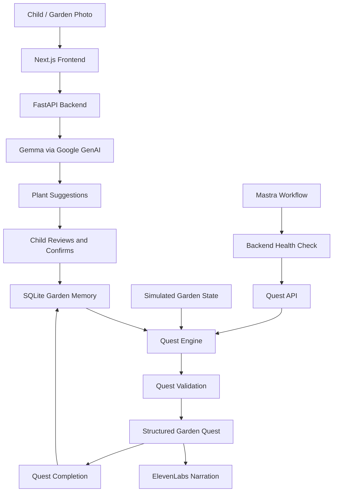

# Empress of Dirt 🌱
### An AI garden companion that turns screen time into real-world adventures.

<p align="center">
  <a href="https://empress-of-dirt-frontend.onrender.com">Live Demo</a> ·
  <a href="https://github.com/S-Bhardwaj21/empress-of-dirt">Source Code</a> ·
  <a href="https://empress-of-dirt.onrender.com/docs">API Documentation</a>
</p>

**Empress of Dirt** is an AI-powered garden companion designed to help children explore nature through personalized outdoor quests. It combines visual plant discovery, persistent garden memory, structured quest generation, simulated environmental context, and dynamic voice narration.

The idea started with a simple question: *What if AI gave children a reason to put their phones down and explore the world around them?*

Instead of creating another app that competes for attention, Empress of Dirt uses technology to encourage curiosity beyond the screen.

> **AI stays inside. The kid goes outside.**

## Table of Contents

- [Features](#features)
- [System Architecture](#system-architecture)
- [Technology Stack](#technology-stack)
- [Application Workflow](#application-workflow)
- [Project Structure](#project-structure)
- [Getting Started](#getting-started)
- [Environment Variables](#environment-variables)
- [API Reference](#api-reference)
- [Mastra Orchestration](#mastra-orchestration)
- [Garden Sensor Simulation](#garden-sensor-simulation)
- [Deployment](#deployment)
- [Engineering Considerations](#engineering-considerations)
- [Roadmap](#roadmap)

## Features

- **AI-assisted plant discovery:** Analyze uploaded garden photographs with Gemma through Google's GenAI service.
- **Human-in-the-loop confirmation:** Review, edit, and select plant suggestions before saving them to garden memory.
- **Persistent garden memory:** Store confirmed plant discoveries, garden profiles, and quest outcomes using SQLite.
- **Structured quest engine:** Generate outdoor activities with titles, stories, instructions, difficulty levels, duration estimates, verification criteria, and safety notes.
- **Context-aware adventures:** Use saved garden information and quest history to make future activities more relevant.
- **Dynamic voice narration:** Generate spoken quest instructions using ElevenLabs.
- **Environmental context:** Simulate soil moisture, temperature, humidity, weather, and time of day to support garden scenarios.
- **Agent workflow:** Use a Mastra workflow to check backend availability and request a garden quest.
- **Cloud deployment:** Host the frontend and backend as separate Render services.

## System Architecture



The application separates presentation, API handling, AI integrations, memory, quest logic, validation, and orchestration into distinct components.

The currently deployed user flow runs through the Next.js frontend and FastAPI backend. The Mastra workflow is a separate orchestration entry point, and garden telemetry currently comes from a simulator rather than a physically connected Arduino UNO Q.

## Technology Stack

| Layer | Technology | Responsibility |
|---|---|---|
| Frontend | Next.js, React, TypeScript | Interactive garden and quest experience |
| UI and animation | Framer Motion, Lucide React | Motion and interface components |
| Backend | Python, FastAPI, Uvicorn | HTTP API and application services |
| Vision | Gemma via Google GenAI | Garden-image analysis |
| Memory | SQLite | Garden profiles and quest history |
| Quest engine | Python | Quest generation and selection |
| Validation | Python rule-based validator | Quest constraint and safety checks |
| Voice | ElevenLabs API | Dynamic quest narration |
| Orchestration | Mastra, TypeScript/JavaScript, Zod | Health-check and quest-request workflow |
| HTTP client | HTTPX | Backend service integrations |
| Frontend deployment | Render | Hosted web interface |
| Backend deployment | Render | Hosted Python API |
| Version control | Git and GitHub | Source control |

## Application Workflow

### 1. Garden discovery

The child uploads a JPG, PNG, or WEBP garden photograph. The backend validates the upload and sends the image to Gemma through Google GenAI.

The model returns proposed plant identifications and supporting visual evidence. These are suggestions, not guaranteed botanical identifications.

### 2. Human confirmation

The child reviews the suggested plants, edits names if necessary, and selects the discoveries to retain.

Only confirmed selections are submitted to the garden-profile endpoint. This keeps uncertain model output from automatically becoming trusted garden memory.

### 3. Memory persistence

SQLite stores the garden profile and quest history. The backend can retrieve the saved profile when preparing a new quest.

The current implementation uses SQLite; MongoDB Atlas is not a dependency of the deployed memory layer.

### 4. Quest generation

The Python quest engine uses garden context and quest logic to prepare structured outdoor activities. A quest can include:

- Title and quest type
- Narrative story
- Duration and difficulty
- Step-by-step instructions
- Completion verification criteria
- Safety notes

A simulated garden is available when a personalized profile is not present.

### 5. Validation and completion

Quest validation checks the generated quest against application-defined rules. After the child records whether they completed the activity, the backend stores the outcome for future use.

### 6. Voice narration

The frontend sends the active quest to the narration endpoint. The backend uses ElevenLabs to generate speech from the quest content and returns audio to the browser.

Narration depends on the backend's ElevenLabs configuration and external service availability.

## Project Structure

```text
empress-of-dirt/
├── agent/
│   └── __init__.py
├── frontend/
│   ├── app/
│   ├── public/
│   ├── package.json
│   └── ...
├── gemma/
├── memory/
│   ├── database/
│   ├── models/
│   └── repositories/
├── orchestration/
│   ├── index.js
│   ├── package.json
│   └── src/
│       ├── garden-workflow.js
│       ├── run-garden-workflow.js
│       ├── generate-voice.js
│       └── list-voices.js
├── quests/
│   ├── constraints/
│   ├── quest_engine/
│   └── quest_types/
├── sensors/
│   └── simulator/
│       └── garden_state.py
├── verification/
│   └── rules/
├── api.py
├── main.py
├── config.py
└── requirements.txt
```

The frontend and backend are separate applications. The Python modules hold garden state, memory, quest logic, and validation, while the `orchestration/` directory contains the Mastra workflow and related scripts.

## Getting Started

### Prerequisites

- Python 3.10 or newer
- Node.js compatible with the frontend's package requirements
- npm
- API credentials for the external services you want to use

### 1. Clone the repository

```bash
git clone https://github.com/S-Bhardwaj21/empress-of-dirt.git
cd empress-of-dirt
```

### 2. Configure the Python backend

Create and activate a virtual environment:

```bash
python -m venv .venv
```

Windows Command Prompt:

```cmd
.venv\Scripts\activate
```

Install the backend dependencies:

```bash
python -m pip install -r requirements.txt
```

### 3. Configure environment variables

Set the credentials in your local environment before starting the services.

Windows Command Prompt:

```cmd
set GEMMA_API_KEY=your_google_genai_api_key
set ELEVENLABS_API_KEY=your_elevenlabs_api_key
```

These values are for the current terminal session. Never commit real credentials to Git.

### 4. Start the backend

From the repository root:

```bash
python -m uvicorn api:app --reload --host 127.0.0.1 --port 8000
```

Verify that the API is running:

```text
http://127.0.0.1:8000/api/health
```

Interactive API documentation is available at:

```text
http://127.0.0.1:8000/docs
```

### 5. Start the frontend

Open another terminal:

```cmd
cd frontend
npm install
```

Create `frontend/.env.local`:

```env
NEXT_PUBLIC_API_URL=http://127.0.0.1:8000
```

Start the development server:

```cmd
npm run dev
```

Open:

```text
http://localhost:3000
```

### 6. Run the Mastra workflow

Keep the Python backend running. In another terminal:

```cmd
cd orchestration
npm install
node src/run-garden-workflow.js
```

The current workflow uses `http://127.0.0.1:8000` to check the backend and request a quest. Run it locally with the Python API available at that address.

**Note:** The workflow is a separate orchestration entry point; the deployed frontend currently calls the FastAPI quest endpoint directly.

## Environment Variables

| Variable | Required for | Description |
|---|---|---|
| `GEMMA_API_KEY` | Garden image analysis | Server-side Google GenAI credential |
| `ELEVENLABS_API_KEY` | Dynamic narration | Server-side ElevenLabs credential |
| `NEXT_PUBLIC_API_URL` | Frontend API requests | Base URL of the FastAPI service |

The frontend API URL is public configuration, not a secret. AI provider credentials must remain server-side.

For local development, use environment variables or an untracked local environment file. In Render, configure the backend credentials in the service's Environment settings.

## API Reference

The following routes are implemented in the FastAPI application.

| Method | Endpoint | Purpose |
|---|---|---|
| `GET` | `/api/health` | Health check |
| `GET` | `/api/sensors/simulated` | Retrieve a simulated garden scenario |
| `POST` | `/api/garden/analyze` | Analyze an uploaded garden image |
| `POST` | `/api/garden/profile` | Save the confirmed garden profile |
| `POST` | `/api/quest` | Generate a garden quest |
| `POST` | `/api/quest/narrate` | Generate narration for a quest |
| `POST` | `/api/quest/complete` | Record the quest outcome |

### Health check

```http
GET /api/health
```

Example response:

```json
{
  "status": "ok",
  "app": "Empress of Dirt"
}
```

### Simulated sensor readings

```http
GET /api/sensors/simulated?scenario=dry_soil
```

Supported scenarios:

- `healthy_garden`
- `dry_soil`
- `hot_afternoon`
- `low_light`

The response identifies the source as a simulator. These values are test data, not readings from physical sensors.

### Analyze a garden image

```http
POST /api/garden/analyze
Content-Type: multipart/form-data
```

Send the image in the `photo` form field. Supported formats are JPEG, PNG, and WEBP, with a 10 MB upload limit.

### Save a garden profile

```http
POST /api/garden/profile
Content-Type: application/json
```

Example request:

```json
{
  "location": "backyard",
  "plants": ["tulsi", "rose", "mint"]
}
```

The `plants` array should contain the discoveries the user has confirmed.

### Generate a quest

```http
POST /api/quest
```

The endpoint returns a structured quest and associated context from the backend's quest-generation process.

### Narrate a quest

```http
POST /api/quest/narrate
Content-Type: application/json
```

Example request shape:

```json
{
  "quest": {
    "title": "The Shadow Tracker",
    "story": "Find a shadow and study its shape.",
    "instructions": [
      "Find a safe garden object casting a shadow.",
      "Describe its shape and direction."
    ]
  }
}
```

The response contains generated audio when the narration service is configured and available.

### Record completion

```http
POST /api/quest/complete
Content-Type: application/json
```

Example request:

```json
{
  "quest_type": "explorer",
  "title": "The Shadow Tracker",
  "difficulty": 1,
  "completed": true
}
```

For exact request and response schemas, use the interactive API documentation at `/docs`.

## Mastra Orchestration

The Mastra workflow is implemented using `@mastra/core/workflows` and Zod schemas.

The current `empress-garden-quest` workflow contains two sequential steps:

1. **`check-garden-api`** — checks backend health and validates that the API is reachable.
2. **`generate-garden-quest`** — requests a quest from the existing Python quest engine and returns the quest plus its contextual metadata.

The workflow is defined in `orchestration/src/garden-workflow.js` and executed by `orchestration/src/run-garden-workflow.js`.

This keeps the workflow explicit and typed while reusing the existing Python application rather than duplicating the quest engine in JavaScript.

The current implementation is a small orchestration workflow, not an autonomous multi-agent system. The deployed frontend continues to use the FastAPI endpoints directly.

## Garden Sensor Simulation

The sensor simulator provides reproducible environmental scenarios for development and testing.

A simulated garden state includes:

- Soil moisture percentage
- Temperature in Celsius
- Relative humidity
- Weather and time of day
- Garden plants and areas to explore

For example, the `dry_soil` scenario represents a garden with low simulated soil moisture.

The project is designed with a future hardware extension in mind, including Arduino UNO Q. **Physical Arduino sensor integration is not currently claimed as implemented**: the current sensor endpoint uses the Python simulator.

This distinction makes it possible to develop and test quest logic before introducing real hardware.

## Deployment

The current web application is deployed as two Render services.

| Service | URL |
|---|---|
| Frontend | https://empress-of-dirt-frontend.onrender.com |
| Backend | https://empress-of-dirt.onrender.com |
| API health | https://empress-of-dirt.onrender.com/api/health |
| API docs | https://empress-of-dirt.onrender.com/docs |

### Frontend configuration

Set the frontend environment variable:

```env
NEXT_PUBLIC_API_URL=https://empress-of-dirt.onrender.com
```

### Backend configuration

Configure these environment variables in the backend Render service:

- `GEMMA_API_KEY`
- `ELEVENLABS_API_KEY`

The backend must also allow requests from the deployed frontend origin through its CORS configuration.

### Operational notes

- Render free services may spin down after inactivity, so the first request can be slow.
- SQLite data on an ephemeral deployment filesystem may not survive service restarts or redeployments unless persistent storage is configured.
- The Mastra workflow currently targets the local API URL and needs deployment configuration before it can run against the hosted backend.

## Engineering Considerations

- **Human-in-the-loop AI:** Model-generated plant names are reviewed before being stored as confirmed discoveries.
- **Input validation:** Garden uploads are checked for supported content types, empty files, and excessive size.
- **Rule-based constraints:** Quest generation and validation are separated from the presentation layer.
- **Explicit failure handling:** External-service errors should be visible and diagnosable instead of silently replaced by fallback output.
- **Credential isolation:** Provider keys belong in backend environment variables, not client-side bundles or version control.
- **Simulation boundaries:** Simulated environmental data is identified as simulated and should not be confused with physical measurements.
- **Persistence boundaries:** Production deployment requires a deliberate strategy for durable memory beyond an ephemeral filesystem.

## Roadmap

- [ ] Connect Arduino UNO Q and validate real sensor readings.
- [ ] Feed verified environmental telemetry into quest selection.
- [ ] Extend Mastra orchestration beyond health checks and quest requests.
- [ ] Configure the orchestration workflow for the deployed backend.
- [ ] Add automated tests for API contracts, quest validation, and memory persistence.
- [ ] Improve durable database storage for production deployments.
- [ ] Expand age-appropriate quest personalization and safety validation.

## Contributing

Contributions and suggestions are welcome. Useful areas include quest design, accessibility, safety validation, garden-memory behavior, automated testing, and sensor integration.

1. Fork the repository.
2. Create a feature branch.
3. Make a focused change.
4. Run the relevant checks.
5. Open a pull request describing the change and how it was tested.

## License

Check the repository's license file before reusing or redistributing this project.

---

Built with curiosity, a little dirt, and the belief that technology can help us reconnect with the world outside the screen.

**Empress of Dirt — AI stays inside. The kid goes outside.**
